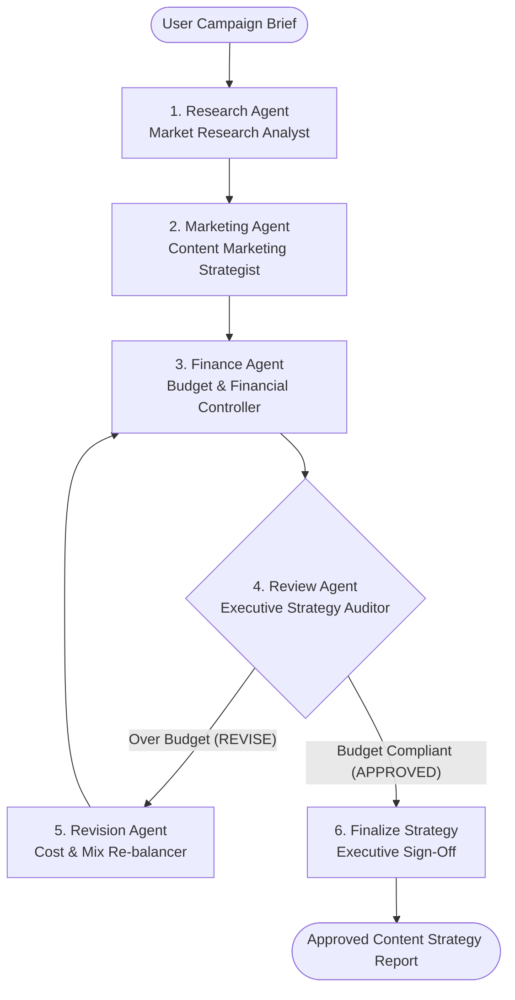

# Practical 6: Multi-Agent Business Workflow

## Developing a “Marketing & Finance” Agent Team using CrewAI and LangGraph to Autonomously Research a Topic and Produce a Budget-Aligned Content Strategy

### Aim
To implement a multi-agent business workflow using **CrewAI** and **LangGraph**, where specialized AI agents collaborate to research a topic, develop a content strategy, estimate costs, and generate a budget-aligned marketing plan.

---

### Objectives
1. Understand multi-agent architectures and their applications in business automation.
2. Study and contrast **CrewAI** (role-based collaboration) and **LangGraph** (graph-based stateful workflows).
3. Create specialized **Research**, **Marketing**, **Finance**, and **Review/Auditor** agents.
4. Generate content strategies grounded in market research, persona pain points, and target channel analysis.
5. Estimate granular line-item marketing expenses and enforce strict adherence to authorized budget ceilings.
6. Implement dynamic feedback and revision loops to automatically correct over-budget proposals.

---

### Multi-Agent Team Structure



1. **Lead Market Research Analyst**: Analyzes industry dynamics, buyer persona friction points, competitive whitespace, and high-intent keyword clusters.
2. **Content Marketing Strategist**: Designs multi-week editorial roadmaps, asset specifications, and channel distribution cadences.
3. **Budget & Financial Controller**: Prices out content production, paid media campaigns, influencer partnerships, software tools, and contingency reserves.
4. **Executive Strategy Director & Auditor**: Fiduciary auditor enforcing hard budget ceilings, ROI targets, and balanced channel allocations. Triggers revisions if constraints are breached.

---

### Comparison: CrewAI vs LangGraph

| Dimension | CrewAI | LangGraph |
|:---|:---|:---|
| **Approach** | Role-based collaboration | Graph-based state machine |
| **Coordination** | Agents and sequential tasks | Nodes, edges, and state transitions |
| **Key Features** | Persona-driven prompt engineering, delegation | Conditional execution, dynamic loops, typed checkpoints |
| **Over-Budget Handling** | Linear auditor adjustment during review | Cyclical feedback loop (`review` $\rightarrow$ `revision` $\rightarrow$ `finance`) |
| **Best Suited For** | Collaborative creative ideation | Complex, stateful, rule-governed workflows |

---

### Campaign Scenarios

1. **Enterprise GreenTech & ESG Analytics Platform**: $25,000 budget, 8 weeks, B2B enterprise CSOs and CFOs.
2. **AI Clinical Workflow & Remote Patient Monitoring**: $40,000 budget, 12 weeks, hospital network clinical leaders.
3. **Circular Regenerative D2C Apparel Launch (Stress Test)**: $15,000 budget, 6 weeks. Initial unconstrained proposal requests $24,800 (+65% overrun). Forces Review Agent rejection and validates automated convergence within ceiling on iteration 2.

---

### Execution via GitHub Actions

Trigger the workflow remotely with GitHub CLI:
```bash
gh workflow run practical-06.yml -R Meerablip/GenAI-Lab
```

Or run smoke test mode:
```bash
gh workflow run practical-06.yml -f smoke=true -R Meerablip/GenAI-Lab
```

Results are published to `$GITHUB_STEP_SUMMARY` and uploaded as workflow artifacts (`practical-06-part-a`, `practical-06-part-b`, `practical-06-comparison`).
